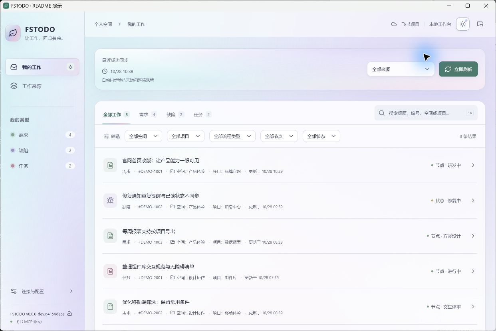
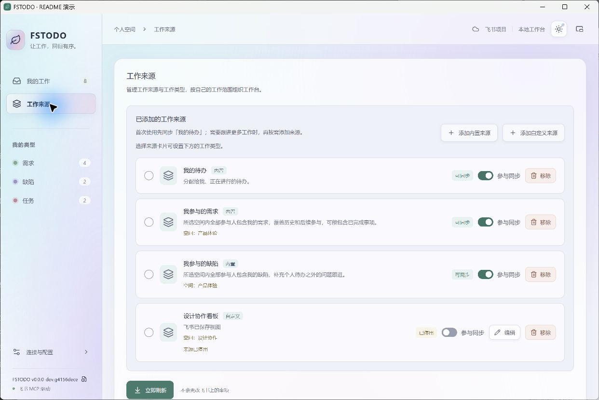
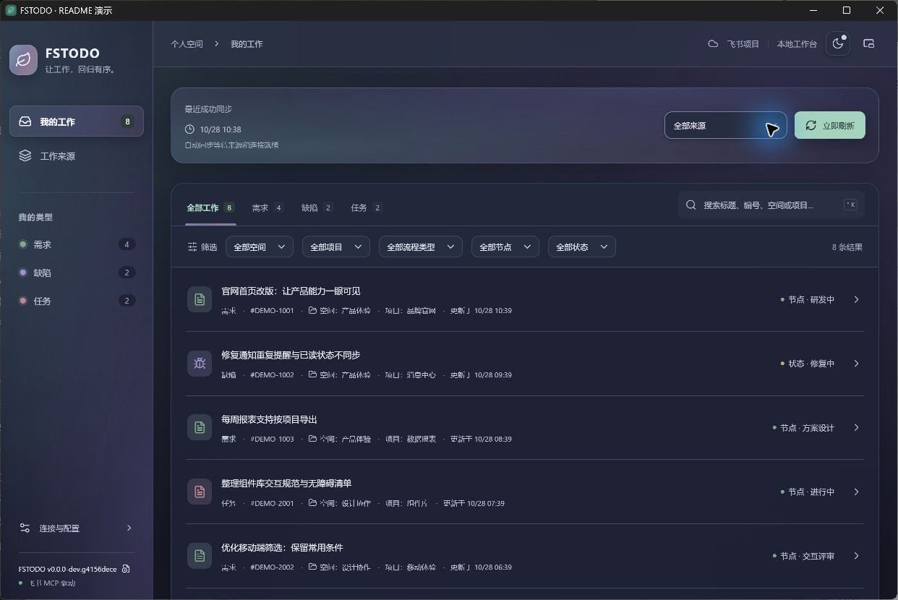

# FSTODO · 飞书项目个人工作台

**让工作，回归有序。**

通过飞书项目 MCP，把与你有关的需求、缺陷和任务集中到本地桌面清单。少切页面，快速找到自己的工作，按需查看详情、填写字段和推进流程。

[下载安装](https://github.com/lihuabeass-art/feishu-project-mcp-workbench/releases/latest) · [使用与开发文档](docs/README.md) · [产品立意](docs/design/产品定位与演进方向.md) · [MIT 开源协议](LICENSE)



> 截图来自真实 Windows 桌面演示实例，使用珍珠全息主题与虚构事项。演示实例没有配置飞书凭证，展示本地缓存与界面；不包含公司数据，不代表联网同步或流程写入验收。

## 你的工作，一处看清

| 功能 | 可以做什么 |
| --- | --- |
| 个人工作清单 | 汇总我的待办、我参与的需求与缺陷；也可配置类型查询或飞书普通已保存视图 |
| 搜索与筛选 | 按标题、编号、空间或项目搜索，组合空间、项目、类型、流程节点与状态筛选 |
| 完整事项详情 | 分层查看负责人、角色、业务字段、正文、链接和图片；图片可缩放、拖动预览 |
| 手动与自动同步 | 缓存先展示，后台按来源检查；网络或接口失败时保留已有数据并支持重试 |
| 流程与字段填写 | 根据远端配置显示可用动作与表单，支持本机草稿、提交前完整核对、写后远端回读核验 |
| 工作类型管理 | 发现类型、按来源选择同步范围、自定义本机别名、隐藏及调整显示顺序 |
| 清单小窗 | 同一窗口切换到紧凑清单，与完整模式共用筛选，支持置顶、详情与窗口位置恢复 |
| 外观与桌面 | 日间、暗黑、跟随系统；经典绿意与珍珠全息；提供跟随虚拟桌面设置 |
| 完整包更新 | 自动检查 GitHub Releases，后台下载并验证签名，准备好后提示，经你确认重启安装；可关闭自动更新，当前版本记录可离线查看 |

实际数据与操作权限由飞书项目决定。流程操作会再次核对云端状态；写入结果不确定时保留草稿，先回读确认，避免重复提交。支持的字段与限制见[节点填写与草稿](backend/docs/节点填写与草稿.md)和[写侧验收手册](backend/docs/写侧验收手册.md)。

## 从完整工作台，到桌边小清单

完整模式适合集中处理工作；清单模式只保留当前需要看的事项。两种模式共用当前筛选，窗口尺寸与位置分别记住。

<p align="center">
  
</p>

## 按自己的范围组织工作

从内置工作来源开始，需要时再增加自定义来源。来源启用、类型选择、显示别名与清单筛选各有明确作用，适合把跨空间、跨项目的个人事项收在一起。



## 全息色彩，也有暗黑模式

主题在整页和弹出层同步切换，也可跟随系统；珍珠全息主题保留柔和的青、紫、粉色层次。



## 安装与连接

在 [Releases](https://github.com/lihuabeass-art/feishu-project-mcp-workbench/releases) 选择适合的平台，普通使用不需要安装 Node.js、Rust 或数据库。

| 平台 | 首次安装 | 应用内更新 |
| --- | --- | --- |
| Windows x64 | 下载并运行 `FSTODO_<版本>_x64-setup.exe`；缺少 WebView2 时安装程序会联网补装 | 后台下载并验签，确认重启后自动完成升级 |
| macOS 13+，Apple Silicon / Intel | 下载 Universal `.dmg` 并安装 | 后台下载并验签，确认后使用 Universal `.app.tar.gz` 替换应用并重启 |

macOS 当前采用 ad-hoc 签名，尚无 Apple Developer ID 与公证；首次打开可能需要在系统设置中允许。Updater 包签名与 Apple 公证用途不同，安装及钥匙串说明见[macOS 构建与安装](docs/macos试用版构建.md)。

1. 打开「连接与配置」，点击「获取 Token」进入[飞书项目 MCP 配置页](https://project.feishu.cn/b/mcp)，按页面提示登录、启用 MCP 并选择所需权限。
2. 在「连接 MCP」区域选择 **HTTP Header**，点击 **复制 Token**。返回软件粘贴并点击「保存 Token」；只需填写 Token 本身，无需整段 JSON 配置。
3. 点击「检查连接」，在「工作来源」启用需要的范围，首次可从「我的待办」开始。
4. 返回「我的工作」刷新，之后可在完整工作台和清单小窗之间切换。

找不到入口时，可从飞书工作台打开「飞书项目」，进入「MCP & CLI / 连接你的 AI 工具」；也可在飞书项目左下角个人头像菜单选择「配置 MCP」。软件内的「查看教程」提供可离线查看的步骤图，官方入口说明见[飞书项目帮助中心](https://project.feishu.cn/b/helpcenter/1ykiuvvj/qaq5d7ru#02f9a76f)。

保存 Token 后仍可随时重新查看教程。「Token 已保存」表示本机已保存凭证，需点击「检查连接」确认当前连接；凭证验证失败、飞书侧权限不足与网络连接失败会分别提示，网络失败不会被判定为 Token 错误。

MCP 服务地址需使用 HTTPS；你需要拥有飞书项目及相应事项的访问权限。Token 从你自己的飞书项目环境获取，本项目不提供公共凭证或 OAuth 登录。

## 数据留在原来的软件

**数据和业务规则留在原软件，FSTODO 改善人与这些数据交互的体验。** 本地保存缓存、个人偏好、草稿及运行台账，业务写入仍通过飞书项目完成。

对于推进节点这类固定、高频操作，界面直接展示对象、状态、可选动作和最终值，减少反复向 AI 描述与核对的成本；提交仍保留明确确认与远端回读。这个产品取舍详见[为什么给 MCP 做图形界面](docs/design/产品定位与演进方向.md#为什么给-mcp-做图形界面)。

连接凭证在本机受保护保存：Windows 使用当前用户的 DPAPI，macOS 使用系统钥匙串参与保护。GitHub 更新检查不携带飞书 Token。复制本地数据库到其他电脑或系统用户，可能需要重新配置凭证。

目前已接入的是飞书项目。多厂商 MCP、滴答清单及自动识别是[演进方向](docs/design/产品定位与演进方向.md)，尚未实现。

## 本地开发

桌面端使用 **Tauri 2 + React + TypeScript**，本地后端使用 **Rust + SQLite**，通过 IPC 复用业务库。需要 Node.js 22+、Rust 1.88+ 和目标系统的桌面构建工具，详细环境见[前端说明](frontend/README.md)。

```sh
git clone https://github.com/lihuabeass-art/feishu-project-mcp-workbench.git
cd feishu-project-mcp-workbench/frontend
npm ci
npm run tauri dev
```

```sh
# 前端检查
npm test
npm run build

# 仓库根目录下检查后端
cd ..
cargo test --locked --manifest-path backend/Cargo.toml
```

`npm run dev` 仅用于浏览器布局预览，不连接真实后端。正式安装包按版本 tag 构建，见[发版流程](docs/release-process.md)与[自动更新说明](docs/auto-update.md)。

## 文档与贡献

- [当前文档索引](docs/README.md)：配置、来源、字段、流程、运行与验证。
- [产品定位与演进方向](docs/design/产品定位与演进方向.md)：保留软件根基，解释[为什么给 MCP 做图形界面](docs/design/产品定位与演进方向.md#为什么给-mcp-做图形界面)，区分现有能力与演进讨论。
- [产品设计与实现](docs/design/飞书个人工作台-设计与实现文档.md)：交互和清单模式的已确认约定。
- [本地后端与 CLI](backend/README.md)：配置、凭证、缓存与命令行入口。
- [历史材料](docs/archive/README.md)：早期调查、交接和验收记录，供追溯参考。

欢迎通过 [Issues](https://github.com/lihuabeass-art/feishu-project-mcp-workbench/issues) 反馈问题或提出改进。提交截图、日志或测试样本前，请移除 Token、真实事项内容和个人信息；开发约定见 [AGENTS.md](AGENTS.md)。

## 开源许可

FSTODO 原创代码采用 [MIT License](LICENSE)。第三方组件保留各自许可证，完整版权、许可文本和源码获取说明见 [THIRD_PARTY_NOTICES.md](THIRD_PARTY_NOTICES.md)，安装包同时携带这些文件。
